# Financial Market Intelligence & Anomaly Detection Platform

An analytics and business-intelligence platform for historical stock-market data. It downloads daily
prices on demand for any symbol Yahoo Finance covers (US, India and other markets), stores them in
PostgreSQL (or SQLite for development), checks data quality, runs statistical and machine-learning
analysis, and presents the results in a ten-page Streamlit dashboard with light and dark themes.

The platform **describes and explains historical behaviour**. It is not a trading system. Its outputs
are not investment advice, predictions, or evidence of market manipulation.

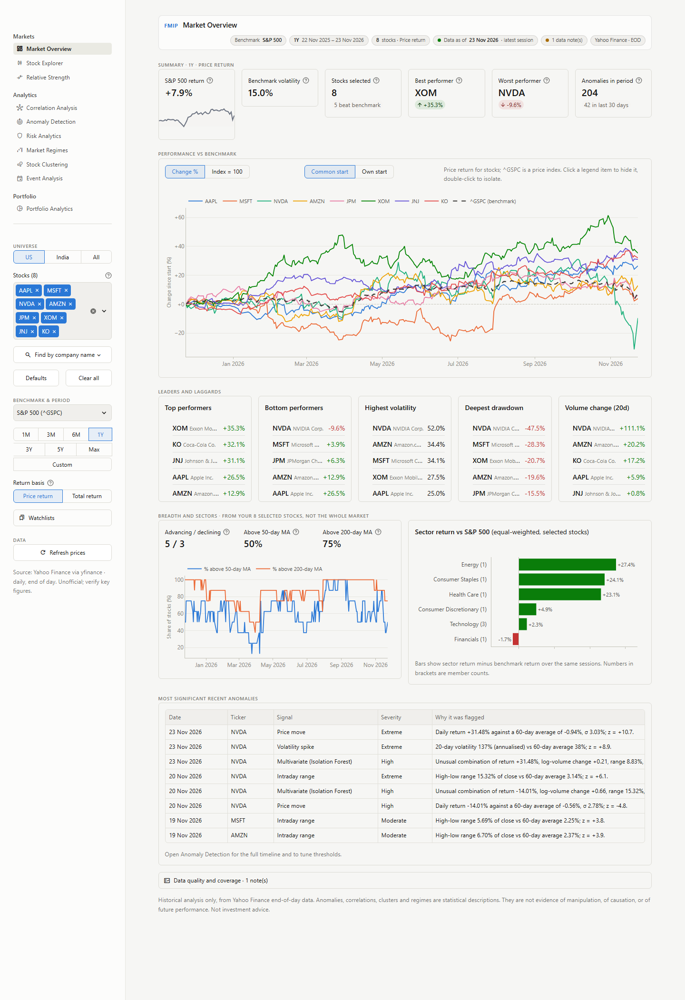

---

## 1. Features

| Area | What it does | Code |
|---|---|---|
| **Dynamic selection** | Pick or type any Yahoo symbol (`AAPL`, `TCS.NS`, `^NSEI`); search by company name across exchanges; market filter (US / India / All); saved watchlists | `app/state.py`, `fmip/data/symbols.py` |
| **Global controls** | Benchmark (S&P 500, NASDAQ, NASDAQ-100, Dow, Russell 2000, NIFTY 50, SENSEX, FTSE, DAX, Nikkei, or any symbol you type); 1M/3M/6M/1Y/3Y/5Y/Max/Custom; price-return or total-return basis. All persist across pages. | `app/state.py` |
| **On-demand data** | New symbols are downloaded automatically (5 years minimum); stored data is the cache; *Refresh prices* fetches only missing sessions | `fmip/data/service.py` |
| **Data integrity** | Full re-download when a split or dividend re-adjusts history; unfinished sessions never stored; nothing forward-filled; quality checks with severity | `fmip/data/service.py`, `fmip/data/quality.py` |
| **Market Overview** | KPI tiles with context; performance vs benchmark (change % or index = 100, common or own start); leaders and laggards; breadth (advancers/decliners, % above 50/200-day MA); sector return vs benchmark; recent anomalies; data-quality panel | `app/views/overview.py` |
| **Stock Explorer** | Candlesticks with MA 20/50/100/200, volume with 20-day average, anomaly markers, 52-week range, beta; tabs for return distribution with VaR/CVaR, rolling volatility, drawdown episodes, rolling returns, comparison, OHLCV table and CSV download | `app/views/explorer.py` |
| **Relative Strength** *(new)* | RS lines vs benchmark, trend status, excess returns over 1W–1Y, rolling relative return, rolling beta | `fmip/analysis/relative.py` |
| **Correlation Analysis** | Pearson/Spearman heatmap (clustered order), strongest and weakest pairs with plain-language interpretation, rolling correlation, sector co-movement | `fmip/analysis/correlation.py` |
| **Anomaly Detection** | Live rolling z-score (price, volume, range, volatility) and Isolation Forest with tunable parameters; severity; one-sentence explanation per flag; timeline; per-stock chart; CSV export | `fmip/analysis/anomalies.py` |
| **Risk Analytics** | Volatility, Sharpe, Sortino, max drawdown, historical and normal VaR, CVaR, beta; risk-return scatter; tail-loss chart; drawdowns; rolling volatility, Sharpe and VaR | `fmip/analysis/risk.py` |
| **Market Regimes** *(new)* | Rule-based trend (MA50/MA200) and volatility regimes with no look-ahead; Gaussian Mixture states with probabilities; regime statistics | `fmip/analysis/regimes.py` |
| **Stock Clustering** | K-means on standardised features, silhouette-guided *k*, PCA map, cluster z-score profiles, nearest peers | `fmip/analysis/clustering.py` |
| **Event Analysis** | Before/during/after returns and volatility, market-adjusted abnormal returns, event-time paths, recovery; seven built-in events plus saved custom events; one-click history backfill | `fmip/analysis/events.py` |
| **Portfolio Analytics** *(new)* | Custom vs equal weights; daily, monthly or buy-and-hold rebalancing; return, volatility, Sharpe, Sortino, drawdown; risk contribution, diversification ratio, effective holdings; correlation between holdings; beta, tracking error and information ratio | `fmip/analysis/portfolio.py` |

## 2. Technology stack

Python 3.10+ (developed on 3.13) · pandas · NumPy · SciPy · scikit-learn · statsmodels ·
SQLAlchemy 2 (PostgreSQL via psycopg2, or SQLite) · yfinance · Streamlit 1.67 · Plotly · pytest.
No dependencies were added in v0.2.

## 3. Architecture

```
 Yahoo Finance (yfinance)                     symbol search (yf.Search)
        │ fetch_history: retries, splits/dividends, exchange time zone
        ▼
 drop_incomplete_session ─► validation.clean_ohlcv ─► CleaningReport
        │
        ▼
 service.ingest_tickers ── plan_fetch_windows (initial / backfill / incremental)
        │                  adjustment_mismatch → full re-download on corporate actions
        ▼
 PostgreSQL / SQLite ◄──► MarketRepository (SQLAlchemy Core, additive migration)
   stocks · sectors · ohlcv_daily · anomalies · analytical_metrics · market_events · watchlists
        │
        ▼
 fmip/analysis/*   pure functions on pandas data (returns, eda, risk, relative, breadth,
 fmip/data/quality correlation, anomalies, regimes, clustering, events, portfolio)
        │
        ▼
 app/  streamlit_app.py (navigation) → state.py (sidebar, selection, header)
       common.py (cached loaders, on-demand ingestion) → views/* → charts.py (Plotly) + theme.py
```

Design rules:

- Analytics modules are **pure functions** over pandas objects. They do not touch the database or
  Streamlit, so all of them are unit-tested offline.
- **The database is the cache.** The provider is called only for missing symbols or date ranges,
  or when the user presses *Refresh prices*. `st.cache_data` caches queries and computations per
  argument set.
- **Global state** (selection, benchmark, period, basis) lives in `st.session_state`. The sidebar is
  drawn once per run by the entry script, so choices persist across pages and changing one control
  never resets another.
- Configuration comes from environment variables (`.env`). Lists in `fmip/universe.py` only seed the
  UI.

```
financial-market-intelligence/
├── .streamlit/config.toml     toolbar, light/dark theme, spacing
├── app/
│   ├── streamlit_app.py       entry point and navigation
│   ├── state.py               global selection, sidebar, watchlists, header
│   ├── common.py              DB connection, cached loaders, on-demand ingestion, live anomalies
│   ├── components.py          KPI tiles, ranked lists, context warnings
│   ├── charts.py              Plotly figure builders
│   ├── theme.py               palette tokens (light/dark), CSS for header/cards
│   └── views/                 ten pages, one module each
├── src/fmip/
│   ├── config.py, universe.py, exceptions.py, logging_config.py
│   ├── data/                  fetcher, validation, quality, symbols, repository, service
│   └── analysis/              returns, eda, risk, relative, breadth, correlation, anomalies,
│                              regimes, clustering, events, portfolio
├── scripts/                   init_db.py, ingest.py, run_analysis.py
├── sql/schema.sql             PostgreSQL DDL
├── tests/                     116 offline, deterministic tests
└── docs/                      METHODOLOGY.md, RESEARCH.md, AUDIT_AND_PLAN.md, screenshots/
```

## 4. Database schema

| Table | Key | Contents |
|---|---|---|
| `sectors` | `id` | Sector names |
| `stocks` | `ticker` | Company name, sector, exchange, currency, quote type, `history_requested_from` (earliest start ever requested, so backfills are not repeated) |
| `ohlcv_daily` | `(ticker, trade_date)` | Open, high, low, close (split-adjusted), adj_close (split- and dividend-adjusted), volume, ingestion time; checks on positive prices and `high >= low` |
| `anomalies` | `id`, unique `(ticker, date, category, method)` | Output of `scripts/run_analysis.py` |
| `analytical_metrics` | `(ticker, as_of_date, metric_name)` | Reserved for scheduled metrics |
| `market_events` | `id`, unique `name` | Default and user-saved events |
| `watchlists` | `name` | JSON list of tickers and the benchmark |

`scripts/init_db.py` (and the dashboard on start-up) creates missing tables and **adds v0.2 columns to
an existing v0.1 database** (additive `ALTER TABLE ... ADD COLUMN` only). The DDL is in
`sql/schema.sql`.

## 5. Data sources and limitations

Yahoo Finance via `yfinance` was chosen after comparing Alpha Vantage (free tier: 25 requests a day,
adjusted series premium-only), Nasdaq Data Link (free WIKI prices frozen since 2018; current EOD
premium), Stooq (CSV endpoint now behind a browser challenge) and exchange files. See
[docs/RESEARCH.md](docs/RESEARCH.md) §1.

- Unofficial and revisable; meant for personal and research use. Check Yahoo's terms before any
  commercial use or redistribution.
- `Close` is split-adjusted and `Adj Close` is also dividend-adjusted. Indices are **price** indices,
  so the default **price-return** basis compares like with like. Switch to total return for
  dividend-inclusive stock returns.
- End-of-day only. A session is stored only after its exchange has closed.
- Returns are in local currency, with no FX conversion. The dashboard warns on mixed-currency
  selections.

## 6. Analytical methodology

Every formula, convention and threshold is in [docs/METHODOLOGY.md](docs/METHODOLOGY.md): return
conventions, risk metrics, correlation, anomaly detection (z-score and Isolation Forest), severity
bands, clustering, events and abnormal returns, relative strength, breadth, regimes, portfolio maths
and the data-quality rules. [docs/RESEARCH.md](docs/RESEARCH.md) explains why each metric is useful,
what it assumes and where it breaks down, with references.

## 7. Setup (Windows PowerShell)

Requires Python 3.10+ and, for production, PostgreSQL 14+.

```powershell
cd C:\financial-market-intelligence
python -m venv .venv
.\.venv\Scripts\python.exe -m pip install -r requirements-dev.txt
.\.venv\Scripts\python.exe -m pip install -e .
Copy-Item .env.example .env      # then edit DATABASE_URL and settings
```

**Quick start with the bundled SQLite database** (no PostgreSQL needed):

```powershell
$env:DATABASE_URL = "sqlite:///data/fmip_dev.db"
.\.venv\Scripts\python.exe -m streamlit run app\streamlit_app.py
```

Run from the project root so `.streamlit/config.toml` is applied.

**PostgreSQL:**

```powershell
psql -U postgres -c "CREATE DATABASE fmip;"
.\.venv\Scripts\python.exe scripts\init_db.py            # schema, migration and default events
.\.venv\Scripts\python.exe scripts\ingest.py             # default universe from DEFAULT_START_DATE
.\.venv\Scripts\python.exe scripts\run_analysis.py       # optional: store default anomalies
.\.venv\Scripts\python.exe -m streamlit run app\streamlit_app.py
```

Any symbol selected in the dashboard is downloaded automatically. From the command line:
`scripts\ingest.py --tickers RELIANCE.NS TCS.NS ^NSEI --start 2015-01-01`. Re-running is safe; only
missing dates are fetched.

**Tests:** `.\.venv\Scripts\python.exe -m pytest` (116 tests, offline, synthetic seeded data).

To show Streamlit's developer controls while coding, set `toolbarMode = "developer"` in
`.streamlit/config.toml`.

## 8. Screenshots

| | |
|---|---|
| 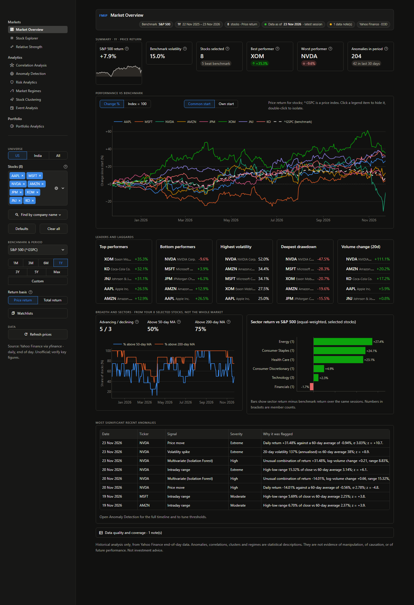 Market Overview (dark) | 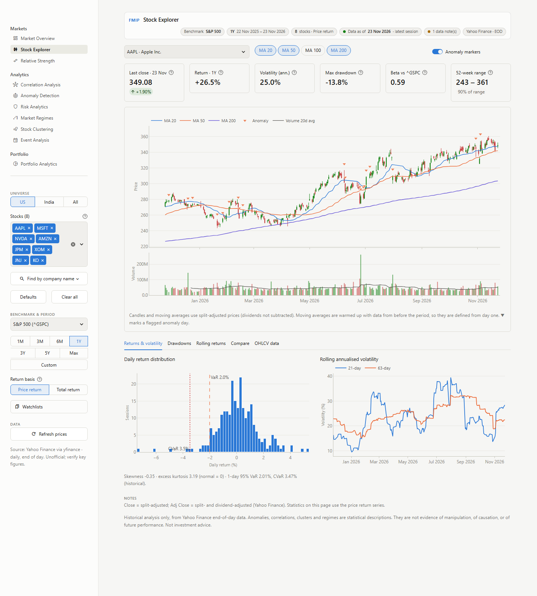 Stock Explorer |
| 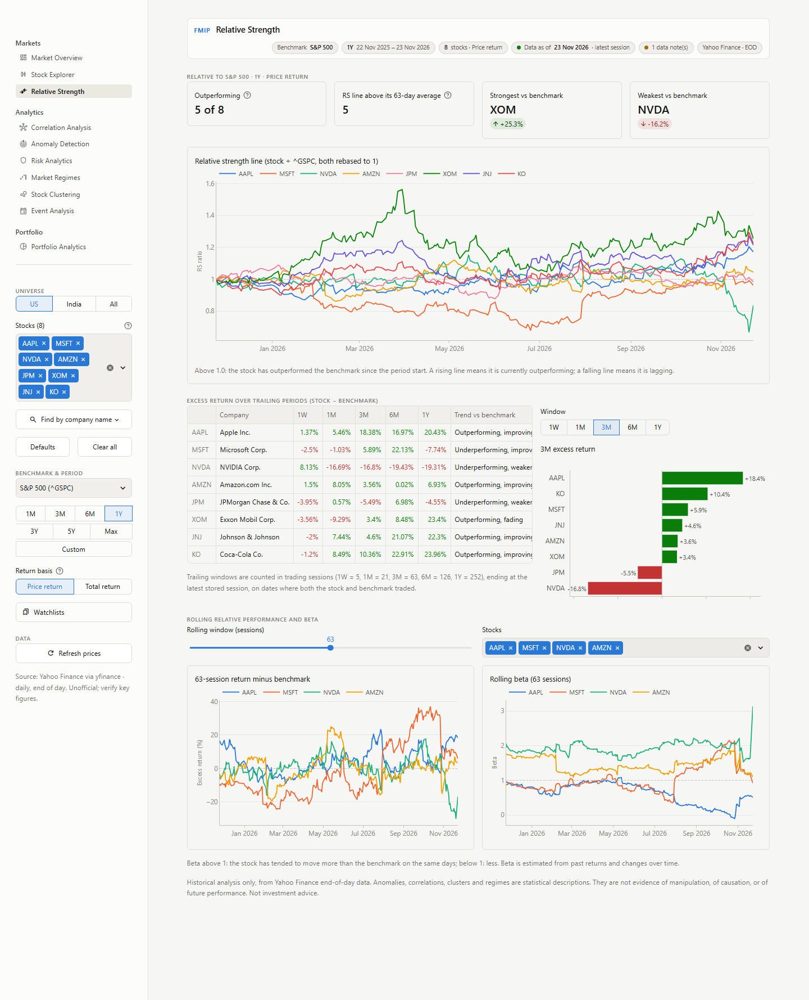 Relative Strength | 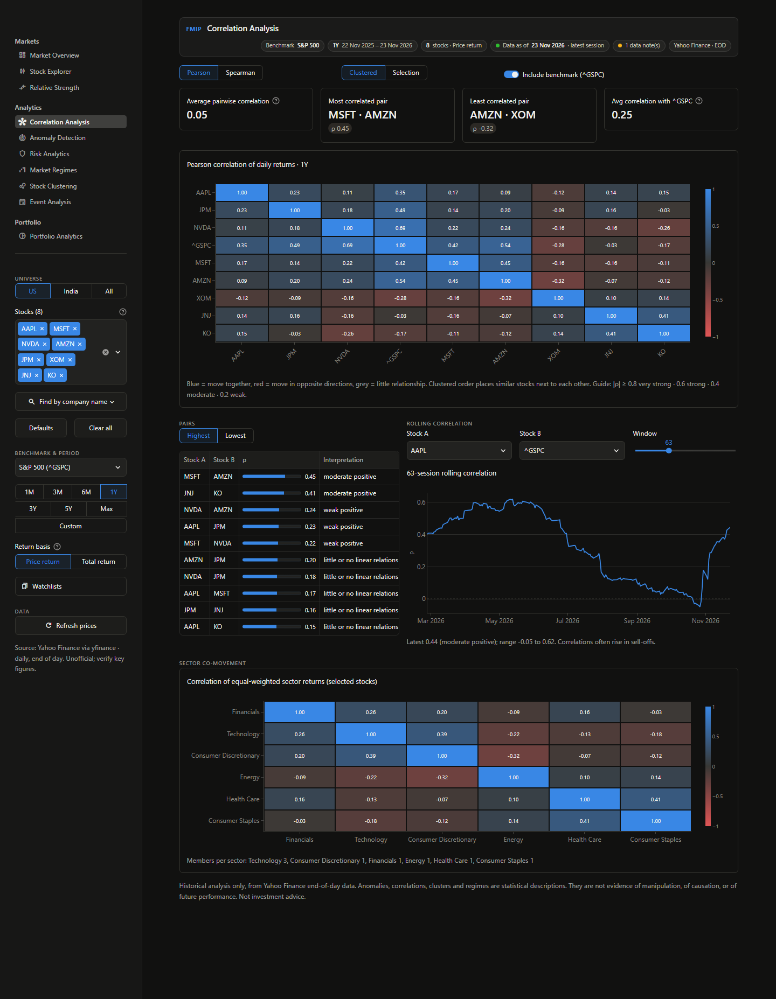 Correlation (dark) |
| 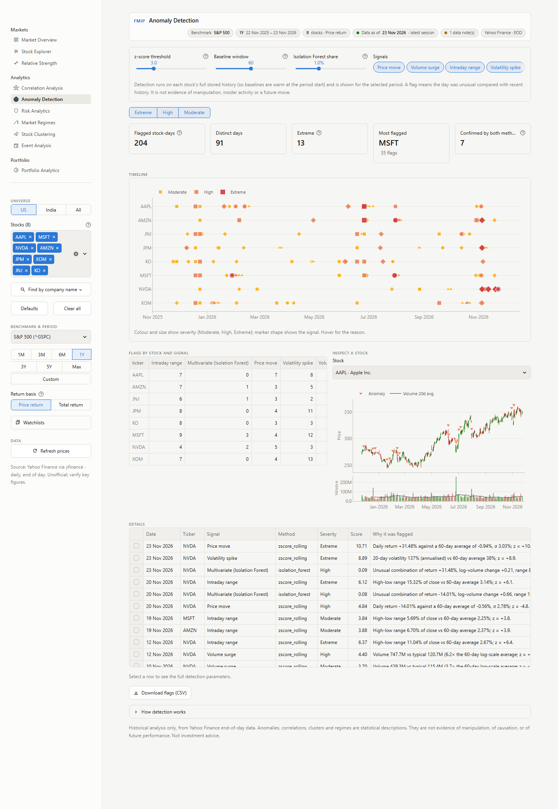 Anomaly Detection | 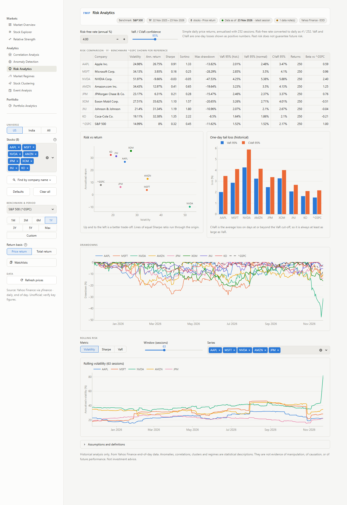 Risk Analytics |
| 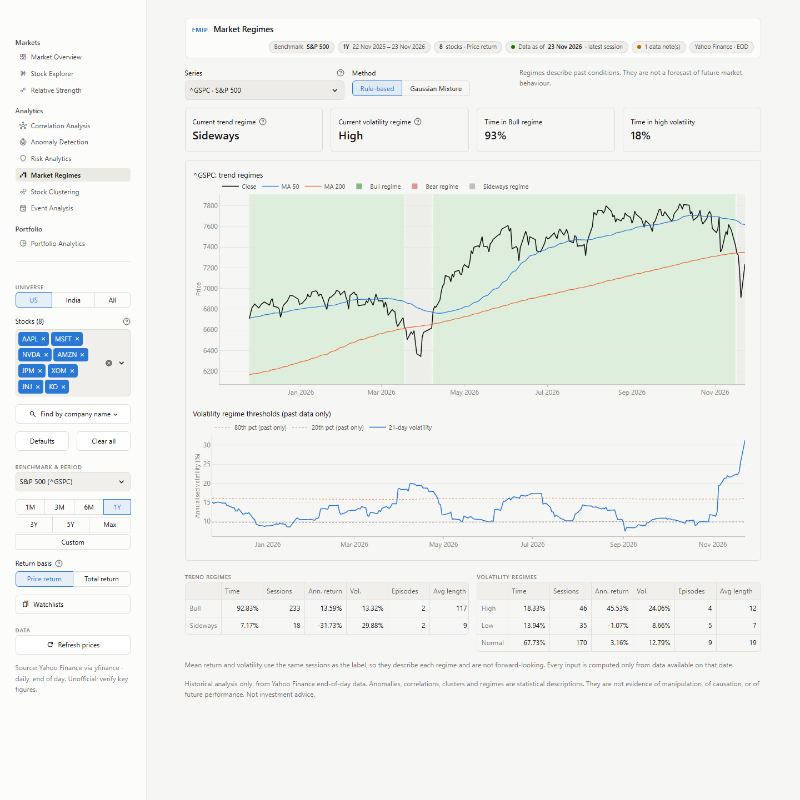 Market Regimes | 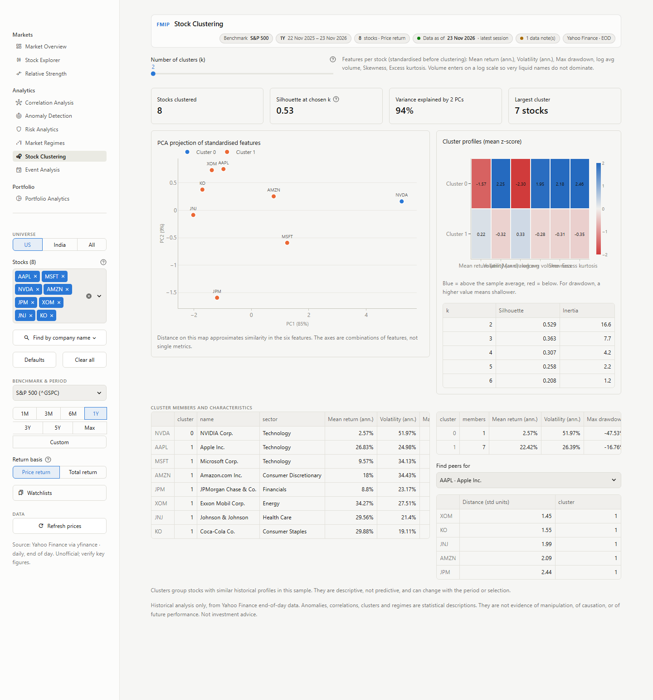 Stock Clustering |
| 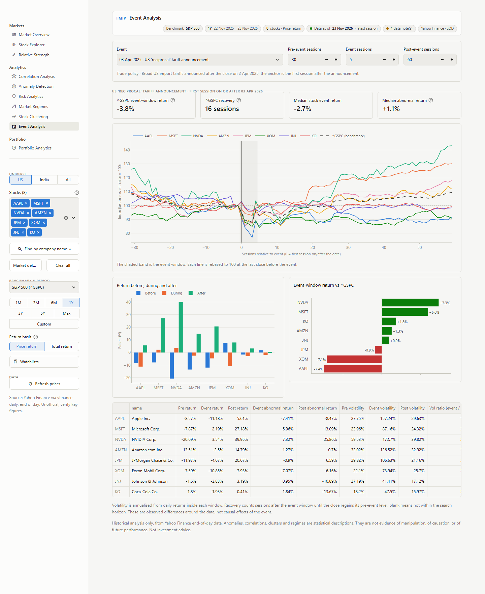 Event Analysis | 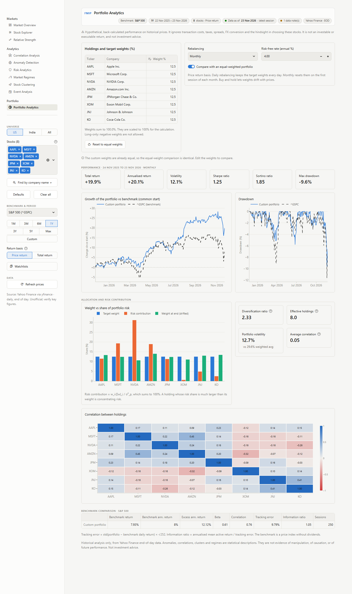 Portfolio Analytics |

Phone width: [docs/screenshots/mobile-overview.png](docs/screenshots/mobile-overview.png).
Screenshots use the default selection (8 US stocks, S&P 500, 1Y to 23 Nov 2026, price return).

## 9. Sample observations

Computed from stored data, not entered by hand. These are historical observations for one sample
and will change with the window or selection.

- **Default selection, 22 Nov 2025 – 23 Nov 2026.** The S&P 500 returned +7.9% with 15.0% annualised
  volatility. XOM (+35.3%), KO (+32.1%) and JNJ (+31.1%) led; NVDA (−9.6%) lagged. 5 of 8 stocks beat
  the index.
- **Unusually low co-movement.** The average pairwise daily-return correlation of the 8 stocks was
  0.05 in that year (calendar 2025: about 0.7 for AAPL, MSFT and JPM against the index). XOM, KO and JNJ
  were negatively correlated with technology names. A month-by-month check found no date
  misalignment; it reflects sector rotation in the sample.
- **Regimes.** By the rule-based classifier, the S&P 500 spent 93% of sessions in a Bull regime over
  the year. It ended in a *Sideways* trend with *High* volatility after the late-November sell-off.
- **Late-November moves.** NVDA moved −14.0% on 20 Nov 2026 and +31.5% on 23 Nov 2026. Both are flagged
  as extreme anomalies (|z| = 4.8 and 10.7) and as data-quality notes to verify against a second
  source.
- **COVID drawdown check.** The S&P 500 maximum drawdown in the stored data is −33.9%, from 19 Feb to
  23 Mar 2020, regained on 18 Aug 2020, which matches the widely reported figure.

## 10. Known limitations

- **Survivorship bias.** The default universe is today's large caps. Results describe survivors.
- **Data source.** Yahoo data is unofficial and can be revised. Large moves are flagged, not
  corrected. Verify important figures.
- **Statistical flags are not evidence.** An anomaly is a day that is unusual compared with recent
  history.
- **Correlation is not causation**, and event windows show observed behaviour, not effects.
- **Regimes are in-sample descriptions** (especially the Gaussian Mixture), not forecasts.
- **Portfolios are hypothetical**: no costs, taxes, spreads, FX or cash drag, and the holdings were
  chosen with hindsight.
- **Breadth covers only the selected stocks**, not the exchange.
- **Sector labels** are approximate (built-in list or Yahoo's sector field).
- **PostgreSQL** upserts and the additive migration are written for both dialects, but the full
  pipeline was verified on SQLite in this environment.
- **Deep link on a cold server.** The first browser session after starting the server on a sub-page
  URL (e.g. `/regimes`) can show Streamlit's "Page not found" notice once, although the page renders.
  Later sessions are unaffected.

## 11. Possible next steps

- Market-model abnormal returns (estimated alpha and beta) and cumulative abnormal return tests.
- Markov-switching regimes (`statsmodels`, already a dependency) with transition probabilities.
- Point-in-time index membership to remove survivorship bias.
- FX conversion to a base currency for mixed-market portfolios.
- A Dockerfile with a PostgreSQL service for one-command setup.

---

Data: Yahoo Finance via yfinance. For education and analysis. Not investment advice.
No price data is included in this repository; each user downloads their own on first run.

Code licensed under the [MIT License](LICENSE).
